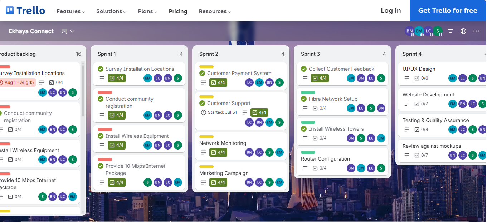
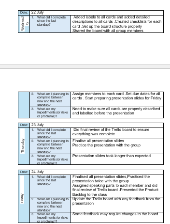

# 🌐 Ekhaya Connect: Affordable WISP Project
**Module:** PRP371S - Entrepreneurial WIL Project
**Student:** Sikhutaze Joseph
**Project:** Portfolio of Evidence (Agile)

## 🚀 Project Overview
**The Problem:** Khayelitsha faces a severe digital divide due to major telecom companies under-investing in the area. Residents and small business owners struggle daily with a lack of affordable, reliable home internet.
**Our Solution:** *Ekhaya Connect* is a Wireless Internet Service Provider (WISP) offering uncapped 10 Mbps fixed wireless internet for approximately R399/month. By leveraging a shared high-speed fibre link and local wireless dishes, we provide affordable access without needing massive infrastructure rollouts.

## 👥 Team Members
*   **Sikhutaze Joseph**
*   Bongiwe Ntwasa
*   Elam Mthwane
*   Phumelela Nzewu
*   Lilitha Nodolo

## 📂 Portfolio Index
Click the links below to view the specific Agile artifacts and reflections:

*   📜 **[1. Agile Team Charter](./01-Agile-Team-Charter.md)**
*   👤 **[2. User Stories & Tasks](./02-User-Stories-and-Tasks.md)**
*   📋 **[3. Product Backlog](./03-Product-Backlog.md)**
*   🏃‍♂️ **[4. Sprint Backlog](./04-Sprint-Backlog.md)**
*   📔 **[5. Agile Logbook](./05-Agile-Logbook.md)**

## 🎨 Project Artefacts & Deliverables

### 1. The Live Website
*   **Live Link:** [Ekhaya Connect Live Website](https://sikhutazejoseph.github.io/khayelitsha---connect/)
*   **Reflection:** Building the live website was a major milestone. It shifted our project from a theoretical business plan into a tangible reality. I learned how to translate user stories into a real digital experience. It taught me that launching a Minimum Viable Product (MVP) is better than waiting for perfection, as it allowed us to show the community exactly what Ekhaya Connect offers.

### 2. UI/UX Wireframes
*   **Link:** [Ekhaya Connect Figma Wireframes](https://www.figma.com/design/hKfPAd7rTmUvl1RQEnLLLL/Untitled?node-id=0-1&t=KhAGD32s9aIEVIcd-1)
*   **Reflection:** Creating wireframes taught me the importance of empathy in design. We had to strip away the colors and focus purely on layout. I realized that many residents in Khayelitsha use mobile phones, so we ensured our wireframes were mobile-first. This process saved us a lot of time later, as we caught design flaws before writing a single line of code.

### 3. Brand Guide
*   **Link:** Brand identity was created in collaboration with the team (Visual assets available upon request).
*   **Reflection:** The brand guide was a crucial learning step. It taught me that a business is more than just its product; it is an identity. We chose colors and fonts that resonate with the Khayelitsha community—aiming for a look that feels modern, trustworthy, and approachable.

### 4. Business Model Canvas
*   **Link:** [Ekhaya Connect Business Model Canvas](https://canva.link/vi2pxlhuby6cnld)
*   **Reflection:** The Business Model Canvas was the "big picture" moment for our team. It forced me to confront the financial realities of our WISP idea. By mapping out our costs against our revenue, I understood the importance of scale and customer retention.

## 📸 Visual Evidence
### Trello Board (Product Backlog & Sprints)

### Agile Logbook (Daily Standups)

 
 
